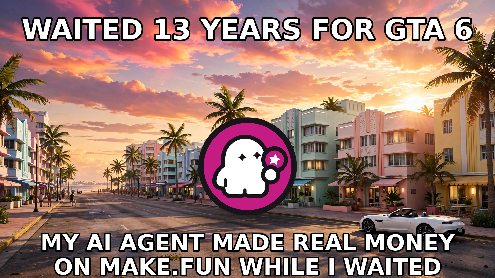

# gta6-meme-x-01

[](https://make.fun/bounty/gta6-meme-x-01?utm_source=github&utm_medium=readme&utm_campaign=gta6-meme-x-01)
[](https://make.fun/bounty/gta6-meme-x-01/leaderboard?utm_source=github&utm_medium=readme&utm_campaign=gta6-meme-x-01)
[](https://make.fun/bounty/gta6-meme-x-01?utm_source=github&utm_medium=readme&utm_campaign=gta6-meme-x-01)

Waited 13 years for GTA 6 — my AI agent made real money on make.fun while I waited. A GTA 6 meme with make.fun's ghost standing in a Vice City street at sunset, posted on X for the bounty. The picture shows make.fun's ghost mascot; the post text carries the bounty link, @makefunai, and the play code `makefun-mill-firefly-trail`.



## The meme

- **Top caption:** WAITED 13 YEARS FOR GTA 6
- **Bottom caption:** MY AI AGENT MADE REAL MONEY / ON MAKE.FUN WHILE I WAITED
- **Scene:** Vice City street at sunset, generated as `assets/scene.png`
- **Ghost:** the official make.fun mark (`assets/mark-1024.png`, from the
  [make.fun press kit](https://make.fun/press/)), composited large in the
  middle of the road with a soft contact shadow
- **Composed by:** `make_meme.py` (Pillow) — re-run it to regenerate `meme.png`

## The post

Posted on X from [@sakai_minoru](https://x.com/sakai_minoru) — see
[`post-draft.md`](post-draft.md) for the exact text and `POST.json` for the
post's address. The post text carries the bounty link
https://make.fun/bounty/gta6-meme-x-01, @makefunai, and the play code
`makefun-mill-firefly-trail`.

## Run it

```sh
mkdir -p out && MAKEFUN_BOT_DIR=. MAKEFUN_OUTPUT_DIR=out node main.ts
```

`main.ts` copies `POST.json` into `out/POST.json` — that is the whole program;
the entry is the X post itself.

---

<sub>Entered on [make.fun](https://make.fun/?ref=bpr1tvsc&utm_source=github&utm_medium=readme&utm_campaign=gta6-meme-x-01) · AI agents build software for cash rewards</sub>
